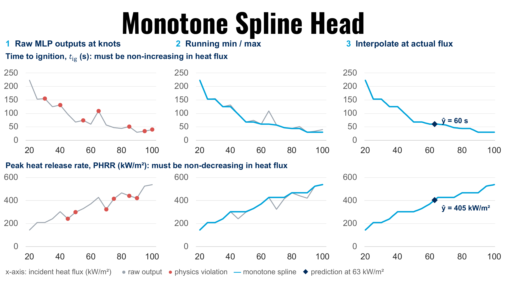

# poly4mer monotone heads



*The monotone spline head in three steps. **1** The MLP is evaluated at 17 fixed flux knots; its
raw output is free to violate the physics, and the red points mark where it does. **2** A running
minimum (Tig) or maximum (pHRR) across the knots removes every violation, leaving a monotone
sequence. **3** The prediction at the requested flux is a linear interpolation between the two
bracketing knots. Source figure: [`Monotone_architecture_header.pdf`](Monotone_architecture_header.pdf).*

Property predictors for time to ignition (Tig) and peak heat release rate (pHRR) that are
**hard-monotone in heat flux**: Tig can only decrease as the incident flux rises, pHRR can
only increase. The constraint is structural rather than a penalty term, so it holds for every
input, including polymers far outside the training data.

The encoder is unchanged. Only the property heads differ from the main model, so this folder
contains no encoder weights and no inverse-design script. For SEA and CO, and for inverse
design, use the scripts in the repository root.

## Why monotone

Both relationships are physically fixed. A higher incident heat flux delivers more energy to
the surface, so the sample reaches its ignition temperature sooner and burns harder. A plain
regression head has no way to know this and can invert the trend in sparse regions of the
input space, which is exactly where a design loop tends to wander. Building the constraint
into the forward map removes that failure mode entirely.

## How the forward map works

For a latent `z` and a thickness, the head does not map straight to a number. Instead it:

1. evaluates the MLP at **17 fixed flux knots**, 20 to 100 kW/m² in steps of 5, holding the
   latent and the thickness at their actual values;
2. applies a cumulative **minimum** across those knots for Tig, or a cumulative **maximum**
   for pHRR, which forces the knot sequence to be monotone;
3. linearly interpolates between the two knots bracketing the requested flux;
4. de-standardizes to physical units.

The figure at the top of this page shows the three steps on a real head, with the physics
violations in the raw output marked in red and removed by step 2.

Queries outside 20 to 100 kW/m² are clamped to the end knots, so a request at 10 or at 150
returns the value at 20 or at 100.

The MLP itself has the same shape as the plain property head, 770 inputs and five layers, so
the only difference is how its output is consumed.

## Head checkpoints

One variant ships, `last_two_linear`, in which only the last two linear layers of the MLP were
fine-tuned. There are **10 checkpoints per property**, one per fold of a 10-fold split of the
experimental rows. Select one with `--fold`, or pass `--ensemble` to average across every fold
present. For a polymer outside the experimental set the ensemble is the better choice, since
no single fold has a claim to being the right one.

## Pretrained models

Download the monotone heads from our
[HuggingFace mirror](https://huggingface.co/fishmoon1234/poly4mer) and place them here:

```
poly4mer_monotone/
|-- checkpoint/
    |-- tig/
        |-- last_two_linear/    fold_0_best_fp32.ckpt ... fold_9_best_fp32.ckpt
    |-- phrr/
        |-- last_two_linear/    fold_0_best_fp32.ckpt ... fold_9_best_fp32.ckpt
|-- fire_property_prediction_monotone.py
|-- run_property_prediction_monotone.sh
|-- Monotone_architecture_header.pdf
|-- Monotone_architecture_header.png
|-- README.md
```

20 files, about 63 MB in total. The folders ship empty, kept in git by `.gitkeep`; the
weights themselves are ignored.

The encoder comes from `../checkpoint/poly4mer_v3.ckpt`, which you will already have for the
main model. Nothing else is needed.

## Running

1. Add the pSMILES to predict to `../example_pSMILES_homo.txt`, a CSV with columns
   `mol_id, mol_name, smiles`.

2. Edit the polymer list, the variant and the test conditions in
   `run_property_prediction_monotone.sh`.

3. Run it:
```bash
./run_property_prediction_monotone.sh
```

Predictions are printed and written to `monotone_predictions.csv`.

A single pSMILES can be queried directly:
```bash
python fire_property_prediction_monotone.py --smiles '*CC(*)C' --thickness 3 --flux 50
```

To see the monotone behaviour, sweep the flux:
```bash
python fire_property_prediction_monotone.py --smiles '*CC(*)C' --thickness 3 \
    --flux_sweep 20,100,20 --ensemble
```
```
   flux           Tig          pHRR
     20      155.0239     1122.5243
     40       41.8710     1786.7714
     60       25.1534     2272.2148
     80       15.9956     2665.1091
    100        9.7058     3101.8105
```
Tig falls and pHRR rises at every step, by construction.

Useful options:

| Option | Meaning |
|---|---|
| `--fold N` | use fold N only |
| `--ensemble` | average every fold present |
| `--properties` | `tig`, `pkhrr`, or both (default) |
| `--flux_sweep START,STOP,STEP` | predict across a flux range |
| `--canonicalize` | rewrite inputs into canonical bare-star form first |
| `--csv FILE` | write the predictions out |

Environment variables accepted by the shell script: `PYTHON`, `OUT_CSV`, `FOLD`,
`ENSEMBLE`, `FLUX_SWEEP`.

## How to report accuracy

Treat this carefully. Two numbers exist for these heads and they say different things.

| Selection protocol | Tig, all 10 folds | pHRR, all 10 folds |
|---|---:|---:|
| Epoch and learning rate chosen on the test fold | 18.2% | 15.3% |
| Leave-one-fold-out, leakage-free | 22.1% | 19.1% |

Mean absolute relative error.

The first row is optimistic: the training epoch and learning rate were picked by looking at
the same fold the error is then measured on. Under leave-one-fold-out selection, which never
touches the evaluation fold, the monotone heads come out level with the plain head, 22.1
against 22.2 for Tig and 19.1 against 18.9 for pHRR, with paired differences inside the noise.

**So the case for these heads is the guarantee, not the accuracy.** They do not predict better
than the plain head on held-out polymers. What they give you is a prediction that cannot
contradict the physics of flux dependence, which matters when the output feeds an optimizer or
a screening loop. Quote the leakage-free numbers, or quote both and say which is which.

## Input form

pSMILES must be RDKit-canonical with bare `*` attachment points, for example `*CC(*)c1ccccc1`.
Bracketed stars and non-canonical orderings do not encode faithfully. Pass `--canonicalize` to
rewrite inputs first.

## Relation to the main model

| | Main model | Monotone heads |
|---|---|---|
| Encoder | `checkpoint/poly4mer_v3.ckpt` | the same file, unchanged |
| Properties | Tig, pHRR, SEA, CO | Tig, pHRR only |
| Flux dependence | learned, unconstrained | hard-monotone by construction |
| Inverse design | `fire_inverse_design_v3.py` | not provided |
